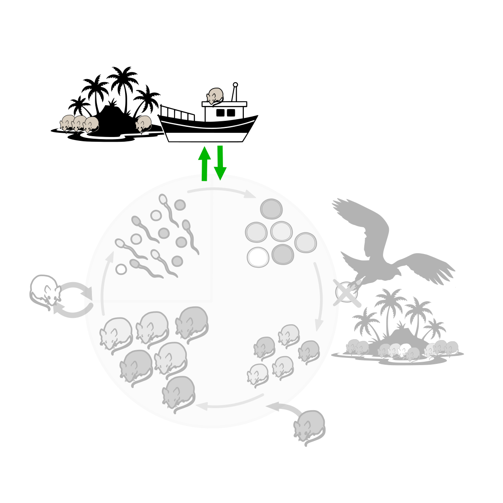

<!-- Remove this box once the page is final (also drop "(folgt)" in the Konzepte menu, _quarto.yml) -->
::: {.construction-box}
**Im Aufbau:** Diese Seite wird noch überarbeitet und in den nächsten Wochen freigeschaltet.
:::



<!-- Intro text left, life-cycle wheel right (stacked on a phone).
     The wheel greys out everything but Genetische Drift: images/lebenszyklus-drift.svg -->
::::: {.intro-pair}
:::: {.intro-text}
In jeder echten Population ist die Zahl der Individuen endlich. Die Zygoten der nächsten Generation sind eine
Stichprobe aus dem Genpool ("Mendel-Lotterie"). Welche Allele weitergegeben werden, ist deshalb teilweise Zufall.
Diese Schwankungen heissen **genetische Drift**. Anders als bei der Selektion gibt es keinen beständigen Zusammenhang
zwischen Genotyp und Fitness. Je kleiner die Stichprobe, desto grösser der Zufallseffekt. Ohne Mutation, Selektion
oder Migration gehen Allele irgendwann verloren oder werden fixiert.
::::
:::: {.intro-figure}
{fig-alt="Lebenszyklus der Mäuse mit Adulten, Gameten, Zygoten und Juvenilen. Hervorgehoben ist die Drift, die übrigen Prozesse sind ausgegraut."}
::::
:::::

## Viele Populationen, gleicher Start

Jede Linie ist eine unabhängige Population (ein Replikat). Alle starten bei derselben Allelfrequenz. Voreingestellt
ist die kleinste Population aus der Vorlesung: $N = 20$, 10 Populationen, 50 Generationen.

```{ojs}
//| panel: input
viewof N = Inputs.range([2, 10000], {value: 20, step: 1, transform: Math.log, label: "Populationsgrösse N"})
viewof p0 = Inputs.range([0.01, 0.99], {value: 0.5, step: 0.01, label: "Start-Allelfrequenz p₀"})
viewof generations = Inputs.range([1, 500], {value: 50, step: 1, label: "Generationen"})
viewof replicates = Inputs.range([1, 100], {value: 10, step: 1, label: "Populationen"})
viewof seed = Inputs.button("Neu simulieren", {value: 1, reduce: (v) => v + 1})
```

```{ojs}
res = R.call("drift_experiment", {N, p0, generations, replicates, seed}, {key: "drift-main"})
alleleTrajectoryPlot(Plot, res.rows, {width, yLabel: "Allelfrequenz p (A₁)", highlight: p0})
```

```{ojs}
summary = res.summary[0]
html`<p class="result">Nach ${generations} Generationen: Mittelwert <b>${summary.mean.toFixed(2)}</b>
${replicates > 1 ? html` · Streuung <b>${summary.sd.toFixed(2)}</b>` : ""}
· fixiert ${summary.fixed} von ${summary.n} · verloren ${summary.lost} von ${summary.n}</p>`
```

## Drift verringert die Variation

Die mittlere Heterozygotie $2pq$ der Populationen (blau) sinkt mit der Zeit, wie die theoretische Erwartung für diese
Populationsgrösse (grau). In der Vorlesung zeigt das Experiment mit Fruchtfliegen dasselbe Muster.

```{ojs}
heterozygosityPlot(Plot, res.heterozygosity, {width})
```

## Populationsgrösse im Vergleich

Die drei Grössen aus der Vorlesung ($N = 20$, $200$, $2000$), je 50 Populationen, 50 Generationen, $p_0 = 0.5$.
Notieren Sie zuerst Ihre Vorhersage.

```{ojs}
//| panel: input
viewof seed_cmp = Inputs.button("Neu simulieren", {value: 1, reduce: (v) => v + 1})
```

```{ojs}
cmp = R.call("drift_by_size", {sizes: [20, 200, 2000], p0: 0.5, generations: 50, replicates: 50, seed: seed_cmp}, {key: "drift-cmp"})
finalFrequencyHistogram(Plot, cmp.rows, {width})
```

```{ojs}
Inputs.table(cmp.summary.map(s => ({"Grösse": s.scenario, "Mittelwert": s.mean, "Streuung": s.sd, "fixiert": s.fixed, "verloren": s.lost})),
  {format: {"Mittelwert": d => d.toFixed(2), "Streuung": d => d.toFixed(2)}, layout: "auto"})
```

## Fragen

Alle Fragen lassen sich mit den Grafiken oben beantworten, ohne Formeln.

1. **Mendel-Lotterie:** Im Genpool ist $p = 0.6$. Daraus entstehen 10 Zygoten, also werden 20 Allele gezogen. Wie
   viele A₁ erwarten Sie? Warum kann trotzdem $p = 0.7$ herauskommen, obwohl kein Genotyp eine höhere Fitness hat?
   Wäre eine so grosse Abweichung bei 1000 Zygoten genauso wahrscheinlich?
2. **Populationsgrösse:** Notieren Sie vor dem Vergleich oben Ihre Vorhersage: Bei welcher Grösse liegen die
   Endfrequenzen am weitesten auseinander, bei welcher ist ein Allel am häufigsten fixiert oder verloren? Begründen
   Sie mit Frage 1.
3. **Fixation:** Stellen Sie $N = 20$, 20 Populationen und 200 Generationen ein. Wo enden die Populationen? Warum
   kann eine Population, die bei $p = 0$ oder $p = 1$ angekommen ist, ohne Mutation oder Migration nie mehr zurück?
4. **Heterozygotie:** Einzelne Populationen schwanken auch wieder Richtung $p = 0.5$. Warum sinkt die mittlere
   Heterozygotie trotzdem immer weiter?
5. **Innerhalb und zwischen Populationen:** Alle Populationen starten gleich. Was passiert im Lauf der Zeit mit der
   Variation *innerhalb* jeder Population, und was mit den Unterschieden *zwischen* den Populationen?
6. **Florida-Puma (Vorlesung):** Um 1990 lebten nur noch etwa 20 bis 30 Florida-Pumas, ihre Heterozygotie sank.
   Nach 1995 wurden Pumas aus Texas freigelassen, danach stieg die Heterozygotie wieder. Erklären Sie beides mit Drift
   und Migration.

::: {.callout-tip collapse="true"}
## Lösungshinweise
1. Erwartet sind $0.6 \cdot 20 = 12$ A₁. Die 20 Allele sind eine Zufallsstichprobe; 14 statt 12 A₁ ($p = 0.7$) ist bei so
   wenigen Ziehungen gut möglich. Bei 1000 Zygoten (2000 Allele) fällt ein Zufall pro Allel viel weniger ins Gewicht,
   die Frequenz bleibt nahe bei 0.6.
2. Bei $N = 20$: Die kleinste Stichprobe hat die grössten Zufallsschwankungen. Darum streuen die Endfrequenzen am
   stärksten, und viele Populationen erreichen 0 oder 1. Bei $N = 2000$ bleiben fast alle nahe bei 0.5.
3. Fast alle enden bei 0 oder 1. Ist ein Allel verloren, kann es nicht mehr gezogen werden; nur Mutation oder
   Zuwanderung könnte es zurückbringen. 0 und 1 sind die einzigen Gleichgewichte der Drift.
4. Populationen, die ein Allel verloren haben, haben für immer $2pq = 0$. Verlust ist endgültig, Rückkehr nicht.
   Mit der Zeit erreichen immer mehr Populationen 0 oder 1.
5. Innerhalb jeder Population geht Variation verloren (Heterozygotie sinkt, Allele werden fixiert). Zwischen den
   Populationen entstehen Unterschiede, weil jede durch Zufall in eine andere Richtung driftet.
6. In einer so kleinen Population ist die Drift stark: Allele gehen zufällig verloren, die Heterozygotie sinkt.
   Die Texas-Pumas brachten Allele mit, die in Florida verloren gegangen oder selten waren. Dieser Genfluss erhöht
   die Variation innerhalb der Population wieder.
:::
