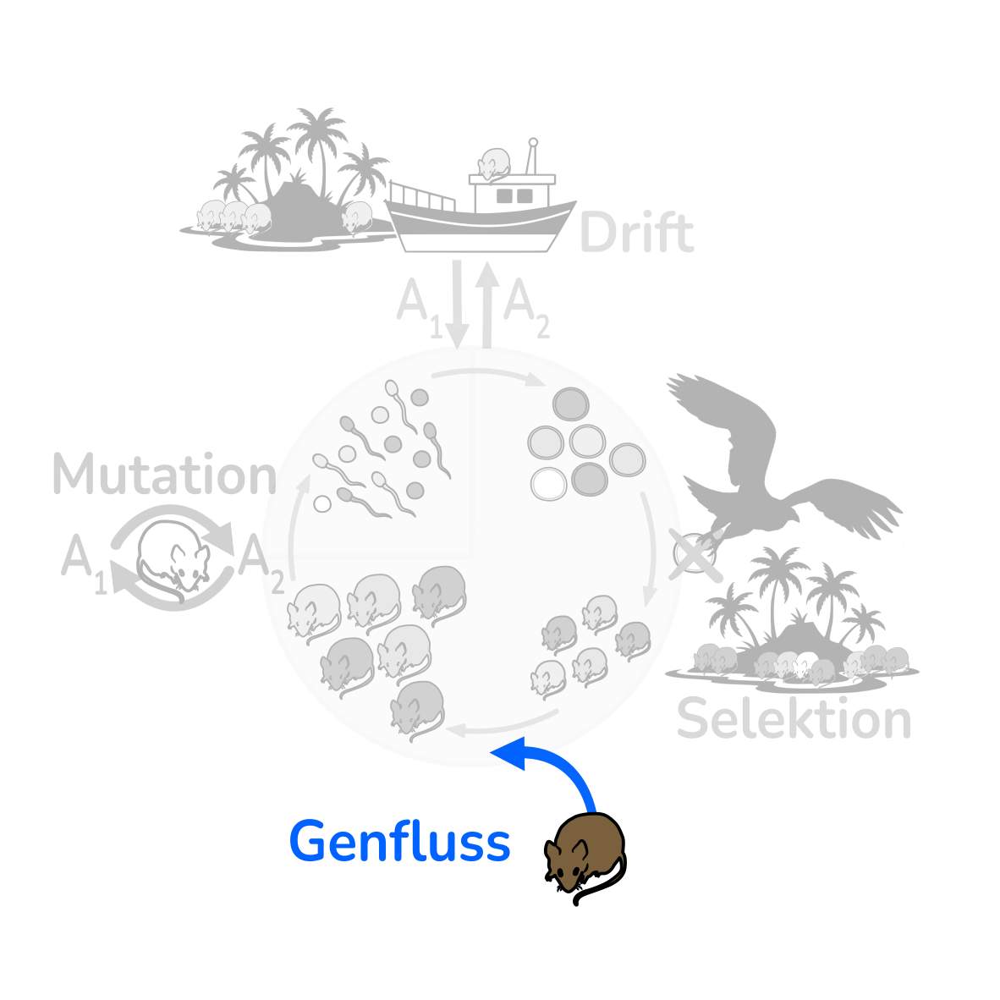

<!-- Remove this box once the page is final (also drop "(folgt)" in the Konzepte menu, _quarto.yml) -->
::: {.construction-box}
**Im Aufbau:** Diese Seite wird noch überarbeitet und in den nächsten Wochen freigeschaltet.
:::



<!-- Intro text left, life-cycle wheel right (stacked on a phone).
     The wheel greys out everything but Migration (Genfluss): images/lebenszyklus-migration.svg -->
::::: {.intro-pair}
:::: {.intro-text}
Migration heisst in der Populationsgenetik **Genfluss**: Zuwanderer pflanzen sich in der neuen Population fort und
bringen so ihre Allele in deren Genpool. Auch Hybridisierung ist aus genetischer Sicht Genfluss.
Im Ein-Insel-Modell fliesst Genfluss nur in einer Richtung, vom Festland ($p_C$) auf die Insel ($p_I$).
Die Migrationsrate $m$ ist der Anteil des Inselgenpools, der aus Zuwanderung vom Festland stammt:

$$
p_I' = (1 - m)\,p_I + m\,p_C \qquad\qquad \Delta p_I = m\,(p_C - p_I)
$$

Im Gleichgewicht ist $\Delta p_I = 0$, also $p_I = p_C$. Migration **gleicht Populationen an**, und sie führt zu
Abweichungen vom Hardy-Weinberg-Gleichgewicht.
::::
:::: {.intro-figure}
{fig-alt="Lebenszyklus der Mäuse mit Adulten, Gameten, Zygoten und Juvenilen. Hervorgehoben ist der Genflusspfeil, die übrigen Prozesse sind ausgegraut."}
::::
:::::

## Insel und Festland

Insel bei $p_0 = 0.4$, Festland bei $p_C = 0.8$. Vergleichen Sie drei Migrationsraten und probieren Sie eine eigene.

```{ojs}
//| panel: input
viewof p0 = Inputs.range([0, 1], {value: 0.4, step: 0.01, label: "Insel: Start-Allelfrequenz p₀"})
viewof pC = Inputs.range([0, 1], {value: 0.8, step: 0.01, label: "Festland: Allelfrequenz p_C"})
viewof m = Inputs.range([0, 0.5], {value: 0.05, step: 0.005, label: "Migrationsrate m (eigener Wert)"})
viewof generations = Inputs.range([1, 200], {value: 50, step: 1, label: "Generationen"})
```

```{ojs}
rows = R.call("simulate_scenarios", {
  scenarios: {"m = 0": {m: 0}, "m = 0.05": {m: 0.05}, "m = 0.2": {m: 0.2}, [`eigener Wert m = ${m}`]: {m}},
  p0, pC, generations
}, {key: "mig-main"})
alleleTrajectoryPlot(Plot, rows, {width, yLabel: "Allelfrequenz p (A₁)", highlight: pC})
```

## Beispiel: Rotwolf und Kojote

In der Vorlesung: Rotwölfe (Allel A₁, $p_0 = 1$) hybridisieren mit Kojoten, die A₁ nicht tragen ($p_C = 0$).
Die Hybridisierung wirkt wie Genfluss vom "Festland" der Kojoten. Werden Hybride sterilisiert, sinkt $m$:
0 % sterilisiert ($m = 0.075$), 50 % ($m = 0.0375$), 90 % ($m = 0.0075$).
Die Vorlesung zeigt diese Kurven über 100 Jahre; das entspricht hier etwa 20 Generationen.

```{ojs}
//| panel: input
viewof gen_rw = Inputs.range([1, 100], {value: 20, step: 1, label: "Generationen"})
```

```{ojs}
rows_rw = R.call("simulate_scenarios", {
  scenarios: {
    "0 % sterilisiert (m = 0.075)": {m: 0.075},
    "50 % sterilisiert (m = 0.0375)": {m: 0.0375},
    "90 % sterilisiert (m = 0.0075)": {m: 0.0075}
  },
  p0: 1, pC: 0, generations: gen_rw
}, {key: "mig-redwolf"})
alleleTrajectoryPlot(Plot, rows_rw, {width, yLabel: "Allelfrequenz p (A₁, Rotwolfallel)"})
```

<!-- Hidden: the N·m ≈ 1 rule and migration versus drift are not covered in the lectures (Keller Vorlesung 9).
## Migration gegen Drift

Kleine Inseln driften stark auseinander. Wie viel Genfluss hält sie zusammen? Eine Faustregel sagt: etwa ein Migrant
pro Generation, also $N m \approx 1$.

```{ojs}
//| eval: false
//| panel: input
viewof N_md = Inputs.range([10, 1000], {value: 50, step: 1, transform: Math.log, label: "Inselgrösse N"})
viewof m_md = Inputs.range([0, 0.2], {value: 0.02, step: 0.001, label: "Migrationsrate m"})
viewof seed = Inputs.button("Neu simulieren", {value: 1, reduce: (v) => v + 1})
```

```{ojs}
//| eval: false
res_md = R.call("experiment", {N: N_md, m: m_md, pC: 0.5, p0: 0.5, generations: 200, replicates: 20, seed}, {key: "mig-drift"})
alleleTrajectoryPlot(Plot, res_md.rows, {width, yLabel: "Allelfrequenz p (A₁)", highlight: 0.5})
```

```{ojs}
//| eval: false
html`<p class="result">Nm = <b>${(N_md * m_md).toFixed(1)}</b> Migranten pro Generation ·
Streuung zwischen den Inseln am Ende: <b>${res_md.summary[0].sd.toFixed(2)}</b></p>`
```
-->

## Fragen

Alle Fragen lassen sich mit den Grafiken oben und mit $\Delta p_I = m\,(p_C - p_I)$ beantworten.

1. **Angleichung:** Insel $p_I = 0.4$, Festland $p_C = 0.8$, $m = 0.05$. Berechnen Sie $\Delta p_I$ in der ersten
   Generation und noch einmal, wenn die Insel bei $p_I = 0.7$ angekommen ist. Warum wird die Angleichung langsamer,
   obwohl $m$ gleich bleibt?
2. **Gleichgewicht:** Setzen Sie $p_C = 0.4$ und starten Sie die Insel einmal bei $p_0 = 0.1$ und einmal bei
   $p_0 = 0.9$. Wo enden beide Inseln? Was bestimmt den Endzustand, und was nicht?
3. **Migration und Hardy-Weinberg:** Auf einer Insel leben 800 A₁A₁-Adulte, vom Festland wandern 200 A₂A₂ zu.
   Berechnen Sie $p$ und die Genotypfrequenzen der Adulten nach der Zuwanderung. Entsprechen sie Hardy-Weinberg?
   Was passiert in der nächsten Generation, wenn sich alle zufällig paaren?
4. **Rotwolf:** Warum bedeuten weniger fruchtbare Hybride ein kleineres $m$? Warum sinkt das Rotwolfallel trotzdem
   in allen drei Szenarien, und was müsste gelten, damit es nicht sinkt?
5. **Gnus:** Gnus wandern jedes Jahr Hunderte Kilometer durch die Serengeti. Warum verändert das die Allelfrequenzen
   ihrer Population nicht?

::: {.callout-tip collapse="true"}
## Lösungshinweise
1. Am Anfang: $0.05 \cdot (0.8 - 0.4) = 0.02$. Bei $p_I = 0.7$: $0.05 \cdot 0.1 = 0.005$. Die Änderung ist proportional
   zum Unterschied zwischen Festland und Insel. Je ähnlicher die beiden schon sind, desto weniger Neues bringen die
   Zuwanderer mit.
2. Beide enden bei $p_C = 0.4$. Der Endzustand hängt nur von $p_C$ ab, nicht vom Start der Insel; der Start bestimmt
   nur, wie lange es dauert. Migration homogenisiert.
3. $p = (2 \cdot 800)/(2 \cdot 1000) = 0.8$. Adulte: A₁A₁ 0.8, A₁A₂ 0, A₂A₂ 0.2. Nach Hardy-Weinberg wären es
   0.64, 0.32, 0.04: Es fehlen alle Heterozygoten. Nach einer Generation Zufallspaarung stellt sich Hardy-Weinberg bei
   $p = 0.8$ wieder ein (wenn keine weiteren Zuwanderer kommen).
4. $m$ ist der Anteil des Rotwolf-Genpools, der aus Kojotenallelen stammt. Sterile Hybride geben keine Allele weiter,
   also kommen weniger Kojotenallele an. Solange $m > 0$ und $p_C = 0$ ist, zieht jede Generation $p$ Richtung 0.
   Nur bei $m = 0$ (keine fruchtbaren Hybride) bleibt $p$ gleich.
5. Die Tiere kehren in ihre Population zurück und pflanzen sich nicht in einer anderen Population fort. Es gelangen
   keine Allele in einen anderen Genpool, also ist es kein Genfluss.
:::
