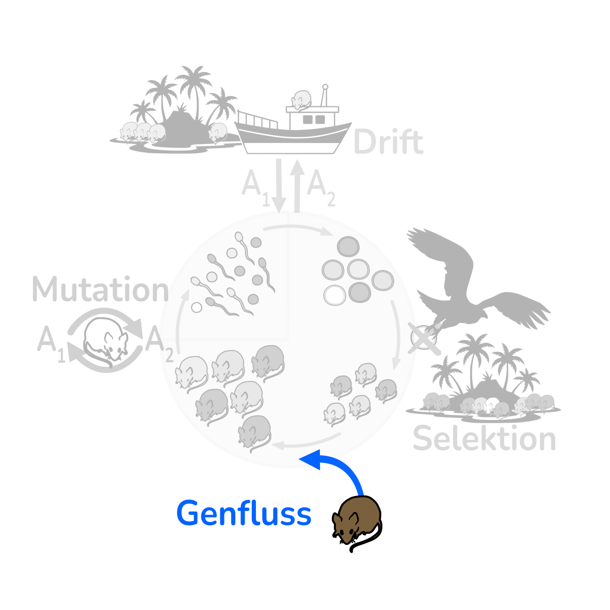



<!-- Intro text left, life-cycle wheel right (stacked on a phone).
     The wheel greys out everything but Migration (Genfluss): images/lebenszyklus-migration.svg -->
::::: {.intro-pair}
:::: {.intro-text}
Migration heisst in der Populationsgenetik **Genfluss**: Allele wandern mit Individuen (oder Pollen, Samen, Gameten)
von einer Population in eine andere. Im Insel-Festland-Modell fliesst Genfluss vom Festland ($p_C$) auf die Insel ($p_I$).
Die Migrationsrate $m$ ist der Anteil des Inselgenpools, der aus Zuwanderern stammt:

$$
p_I' = (1 - m)\,p_I + m\,p_C \qquad\qquad \Delta p_I = m\,(p_C - p_I)
$$

Im Gleichgewicht gilt $p_I = p_C$. Migration **gleicht Populationen an**.
::::
:::: {.intro-figure}
{fig-alt="Lebenszyklus der Mäuse mit Adulten, Gameten, Zygoten und Juvenilen. Hervorgehoben ist der Genflusspfeil, die übrigen Prozesse sind ausgegraut."}
::::
:::::

## Insel und Festland

Insel bei $p_0 = 0.4$, Festland bei $p_C = 0.8$. Vergleichen Sie drei Migrationsraten und probieren Sie eine eigene.

```{ojs}
//| panel: input
viewof p0 = Inputs.range([0, 1], {value: 0.4, step: 0.01, label: "Insel: Start-Allelfrequenz p₀"})
viewof pC = Inputs.range([0, 1], {value: 0.8, step: 0.01, label: "Festland: Allelfrequenz p_C"})
viewof m = Inputs.range([0, 0.5], {value: 0.05, step: 0.005, label: "Migrationsrate m (eigener Wert)"})
viewof generations = Inputs.range([1, 200], {value: 50, step: 1, label: "Generationen"})
```

```{ojs}
rows = R.call("simulate_scenarios", {
  scenarios: {"m = 0": {m: 0}, "m = 0.05": {m: 0.05}, "m = 0.2": {m: 0.2}, [`eigener Wert m = ${m}`]: {m}},
  p0, pC, generations
}, {key: "mig-main"})
alleleTrajectoryPlot(Plot, rows, {width, highlight: pC})
```

## Migration gegen Drift

Kleine Inseln driften stark auseinander. Wie viel Genfluss hält sie zusammen? Eine Faustregel sagt: etwa ein Migrant
pro Generation, also $N m \approx 1$.

```{ojs}
//| panel: input
viewof N_md = Inputs.range([10, 1000], {value: 50, step: 1, transform: Math.log, label: "Inselgrösse N"})
viewof m_md = Inputs.range([0, 0.2], {value: 0.02, step: 0.001, label: "Migrationsrate m"})
viewof seed = Inputs.button("Neu simulieren", {value: 1, reduce: (v) => v + 1})
```

```{ojs}
res_md = R.call("experiment", {N: N_md, m: m_md, pC: 0.5, p0: 0.5, generations: 200, replicates: 20, seed}, {key: "mig-drift"})
alleleTrajectoryPlot(Plot, res_md.rows, {width, highlight: 0.5})
```

```{ojs}
html`<p class="result">Nm = <b>${(N_md * m_md).toFixed(1)}</b> Migranten pro Generation ·
Streuung zwischen den Inseln am Ende: <b>${res_md.summary[0].sd.toFixed(2)}</b></p>`
```

## Fragen

1. Wie hängt die Geschwindigkeit der Angleichung von $m$ ab?
2. Welche Massnahmen würden Naturschutzbiologen ergreifen, um den Genfluss für eine seltene Art zu erhöhen?
3. Warum kann Migration lokale Anpassung behindern?

::: {.callout-tip collapse="true"}
## Lösungshinweise
1. Der Abstand $p_C - p_I$ schrumpft jede Generation um den Faktor $(1 - m)$. Grosses $m$ bedeutet schnelle Angleichung.
2. Wildtierkorridore, Trittsteinbiotope, Umsiedlung von Individuen oder Pollen- und Samentransfer.
3. Zuwanderer bringen immer wieder Allele mit, die lokal schlechter angepasst sind.
:::
