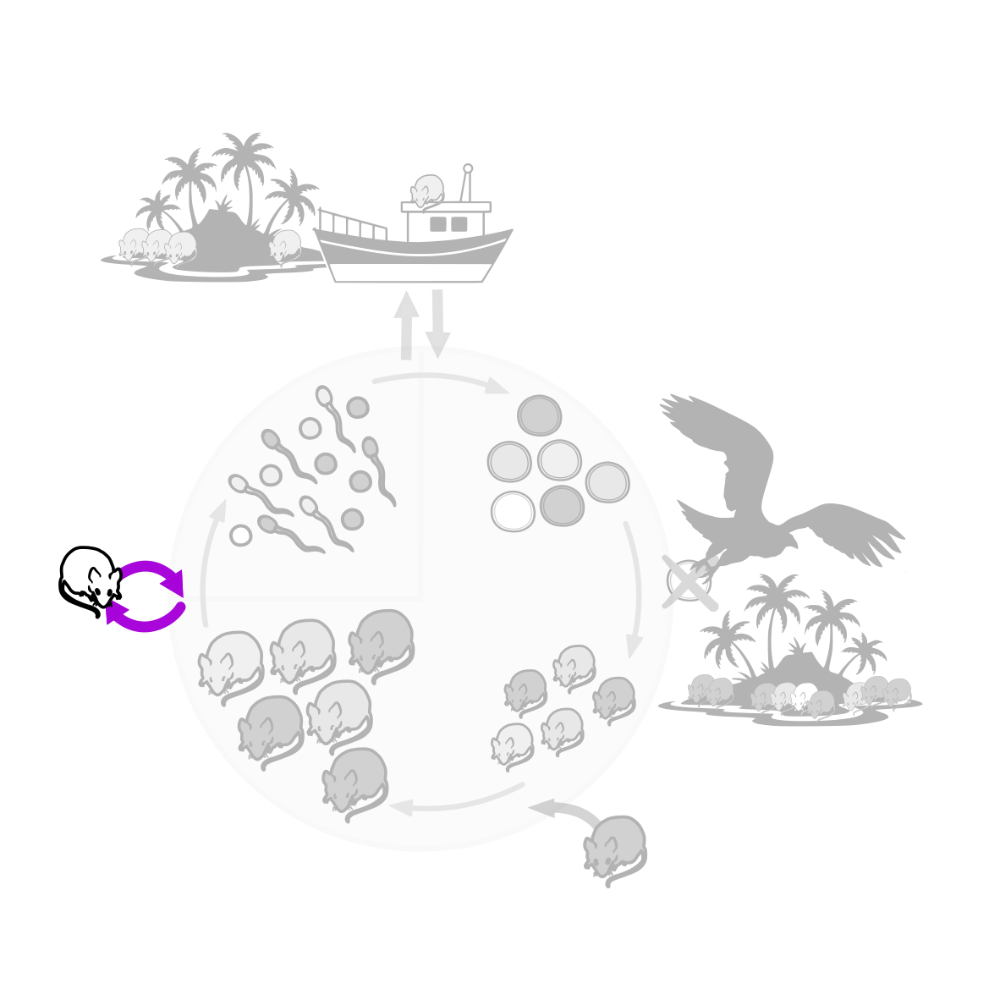



<!-- Intro text left, life-cycle wheel right (stacked on a phone).
     The wheel greys out everything but Mutation: images/lebenszyklus-mutation.svg -->
::::: {.intro-pair}
:::: {.intro-text}
Mutation erzeugt neue Allele. Als Kraft, die Allelfrequenzen verändert, ist sie aber sehr langsam, weil Mutationsraten
klein sind.

Mutationen können in beide Richtungen auftreten: Mit der Mutationsrate $u$ wird das Allel A₁ in A₂ umgewandelt
(Vorwärtsmutation), mit der Mutationsrate $v$ das Allel A₂ in A₁ (Rückmutation). Mit $u$ (A₁ → A₂) und $v$ (A₂ → A₁) gilt also:

$$
\Delta p = v\,q - u\,p = v - p\,(u + v)
$$

mit $p$ der Frequenz von A₁ und $q = 1 - p$ der Frequenz von A₂. Im Gleichgewicht ($\Delta p = 0$) gilt

$$
p^* = \frac{v}{u + v}
$$
::::
:::: {.intro-figure}
{fig-alt="Lebenszyklus der Mäuse mit Adulten, Gameten, Zygoten und Juvenilen. Hervorgehoben ist der Mutationspfeil, die übrigen Prozesse sind ausgegraut."}
::::
:::::

## Mutation allein

Die Vorlesung verwendet $u = 10^{-4}$ und $v = 10^{-5}$. Achten Sie auf die Zahl der Generationen.

```{ojs}
//| panel: input
viewof logu = Inputs.range([-6, -1], {value: -4, step: 0.1, label: "log₁₀ u (A₁ → A₂)"})
viewof logv = Inputs.range([-6, -1], {value: -5, step: 0.1, label: "log₁₀ v (A₂ → A₁)"})
viewof p0 = Inputs.range([0, 1], {value: 1, step: 0.01, label: "Start-Allelfrequenz p₀"})
viewof generations = Inputs.select([1000, 10000, 50000, 100000], {value: 50000, label: "Generationen"})
```

```{ojs}
u = 10 ** logu
v = 10 ** logv
p_hat = R.call("mutation_equilibrium", {u, v}, {key: "mut-eq"})
rows = R.call("mutation_trajectory", {p0, u, v, generations}, {key: "mut-main"})
alleleTrajectoryPlot(Plot, rows.map(d => ({...d, rep: 1})), {width, yLabel: "Allelfrequenz p (A₁)", highlight: p_hat})
```

```{ojs}
html`<p class="result">Gleichgewicht (gestrichelt): <b>p* = ${p_hat.toFixed(3)}</b> · nach ${generations.toLocaleString("de-CH")} Generationen: <b>p = ${rows.at(-1).p.toFixed(3)}</b></p>`
```

## Mutation gegen Selektion

Ein schädliches Allel A₂ entsteht immer wieder neu und wird durch Selektion entfernt. Es stellt sich ein
Gleichgewicht ein: für ein rezessives Allel etwa $q^* \approx \sqrt{u/s}$.

```{ojs}
//| panel: input
viewof s = Inputs.range([0.01, 1], {value: 0.1, step: 0.01, label: "Selektion gegen A₂A₂: s"})
viewof h = Inputs.range([0, 1], {value: 0, step: 0.05, label: "Dominanz von A₂: h"})
viewof logu2 = Inputs.range([-6, -2], {value: -3, step: 0.1, label: "log₁₀ u (A₁ → A₂)"})
```

```{ojs}
u2 = 10 ** logu2
q_hat = R.call("mutation_selection_balance", {u: u2, s, h}, {key: "mut-bal"})
rows_ms = R.call("simulate", {p0: 1, u: u2, s, h, generations: 1000}, {key: "mut-sel"})
alleleTrajectoryPlot(Plot, rows_ms, {width, y: "q", yLabel: "Allelfrequenz q (A₂)", highlight: q_hat})
```

```{ojs}
html`<p class="result">Näherung (gestrichelt): <b>q* ≈ ${q_hat.toFixed(4)}</b> · Simulation nach 1000 Generationen: <b>q = ${rows_ms.at(-1).q.toFixed(4)}</b></p>`
```

## Fragen

1. Wie viele Generationen braucht $p$ von 1 auf 0.9 bei $u = 10^{-4}$? Was folgt daraus für kurze Zeiträume?
2. Warum ist Mutation trotzdem wichtig, etwa für Antibiotikaresistenz?
3. Vergleichen Sie $h = 0$ mit $h = 0.5$. Warum bleiben rezessive schädliche Allele häufiger?

::: {.callout-tip collapse="true"}
## Lösungshinweise
1. Etwa 10 000 Generationen, denn $p_t \approx e^{-ut}$. Über kurze Zeiten verändert Mutation Allelfrequenzen kaum.
2. Mutation liefert die Variation, auf die Selektion wirkt. Bakterien und Viren bilden in grossen Populationen viele Mutanten pro Generation.
3. Rezessive Allele sind in Heterozygoten vor der Selektion versteckt.
:::
