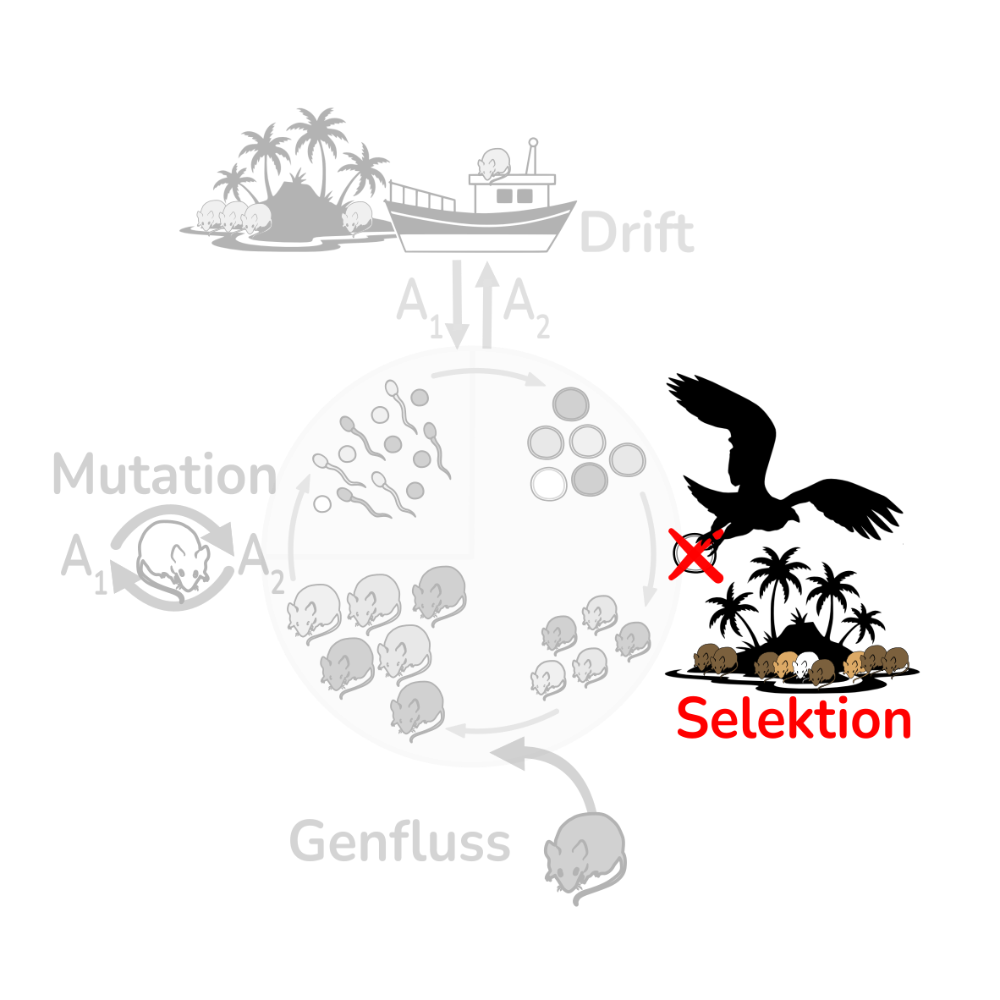



<!-- Intro text left, life-cycle wheel right (stacked on a phone).
     The wheel greys out everything but Selektion: images/lebenszyklus-selektion.svg -->
::::: {.intro-pair}
:::: {.intro-text}
Selektion wirkt, wenn Genotypen unterschiedlich viele überlebende Nachkommen haben. Jedem Genotyp wird dafür eine
**relative Fitness** zugeordnet. In der Vorlesung geschieht das über den Selektionskoeffizienten $s$ und den
Dominanzkoeffizienten $h$:

$$
w_{11} = 1 \qquad w_{12} = 1 - hs \qquad w_{22} = 1 - s
$$

Mit $h = 0$ ist A dominant, mit $h = 1$ rezessiv. Wie schnell sich $p$ ändert, hängt also von der Fitness, von $p$ selbst
und von der Dominanz ab.
::::
:::: {.intro-figure}
{fig-alt="Lebenszyklus der Mäuse mit Adulten, Gameten, Zygoten und Juvenilen. Hervorgehoben ist der Selektionspfeil, die übrigen Prozesse sind ausgegraut."}
::::
:::::

## Ausprobieren

Wählen Sie ein Fallbeispiel oder stellen Sie die Fitness selbst ein.

```{ojs}
//| panel: input
viewof preset = Inputs.select(
  new Map([
    ["Eigene Werte", null],
    ["Laktase-Persistenz (A dominant, w₂₂ = 0.9)", {p0: 0.05, generations: 200, w11: 1, w12: 1, w22: 0.9}],
    ["Fellfarbe Schäferhund (AA letal)", {p0: 0.5, generations: 50, w11: 0, w12: 1, w22: 1}],
    ["Heterozygotenvorteil", {p0: 0.05, generations: 100, w11: 0.85, w12: 1, w22: 0.2}]
  ]),
  {label: "Fallbeispiel"}
)
```

```{ojs}
//| include: false
start = preset ?? {p0: 0.1, generations: 100, w11: 1, w12: 0.95, w22: 0.9}
```

```{ojs}
//| panel: input
viewof p0 = Inputs.range([0, 1], {value: start.p0, step: 0.01, label: "Start-Allelfrequenz p₀"})
viewof generations = Inputs.range([1, 1000], {value: start.generations, step: 1, label: "Generationen"})
viewof w11 = Inputs.range([0, 1], {value: start.w11, step: 0.01, label: "Fitness w₁₁ (AA)"})
viewof w12 = Inputs.range([0, 1], {value: start.w12, step: 0.01, label: "Fitness w₁₂ (Aa)"})
viewof w22 = Inputs.range([0, 1], {value: start.w22, step: 0.01, label: "Fitness w₂₂ (aa)"})
viewof finite = Inputs.toggle({label: "Endliche Population (mit Drift)", value: false})
viewof N = Inputs.range([10, 10000], {value: 500, step: 1, transform: Math.log, label: "Populationsgrösse N", disabled: !finite})
viewof seed = Inputs.button("Neu simulieren", {value: 1, reduce: (v) => v + 1})
```

```{ojs}
res = R.call("experiment", {p0, generations, w11, w12, w22, N: finite ? N : Infinity, replicates: finite ? 10 : 1, seed}, {key: "sel-main"})
alleleTrajectoryPlot(Plot, res.rows, {width})
```

```{ojs}
html`<p class="result">Nach ${generations} Generationen: <b>p = ${res.rows.at(-1).p.toFixed(3)}</b>${finite ? " (Mittel über 10 Populationen)" : ""}.</p>`
```

Genotypfrequenzen (gestrichelt: Erwartung nach Hardy-Weinberg bei gleichem $p$):

```{ojs}
genotypePlot(Plot, res.genotypes, {width})
```

## Dominanz macht den Unterschied

Gleiches $s$, drei Dominanzgrade. Bei seltenen rezessiven Allelen wirkt Selektion kaum, weil sie fast nur in Heterozygoten stecken.

```{ojs}
//| panel: input
viewof s_cmp = Inputs.range([0.01, 1], {value: 0.1, step: 0.01, label: "Selektionskoeffizient s"})
viewof p0_cmp = Inputs.range([0.01, 0.99], {value: 0.05, step: 0.01, label: "Start-Allelfrequenz p₀"})
```

```{ojs}
cmp = R.call("simulate_scenarios", {
  scenarios: {
    "A dominant (h = 0)": {h: 0},
    "additiv (h = 0.5)": {h: 0.5},
    "A rezessiv (h = 1)": {h: 1}
  },
  s: s_cmp, p0: p0_cmp, generations: 300
}, {key: "sel-cmp"})
alleleTrajectoryPlot(Plot, cmp, {width})
```

## Fragen

1. **Laktase:** Warum steigt A am Anfang nur langsam, obwohl die Selektion konstant ist?
2. **Schäferhund:** Warum verschwindet A nicht ganz, obwohl AA letal ist?
3. Ein schädliches rezessives Allel wird nur langsam eliminiert, selbst wenn $s$ gross ist. Warum?

::: {.callout-tip collapse="true"}
## Lösungshinweise
1. Selektion wirkt nur gegen aa. Solange A selten ist, steckt es fast nur in Heterozygoten, und es gibt kaum aa, gegen die selektiert werden kann.
2. Ist A selten, steckt es fast nur in gesunden Heterozygoten und entgeht so der Selektion.
3. Auch hier: Seltene rezessive Allele sind fast nur in Heterozygoten, wo sie nicht sichtbar sind.
:::
