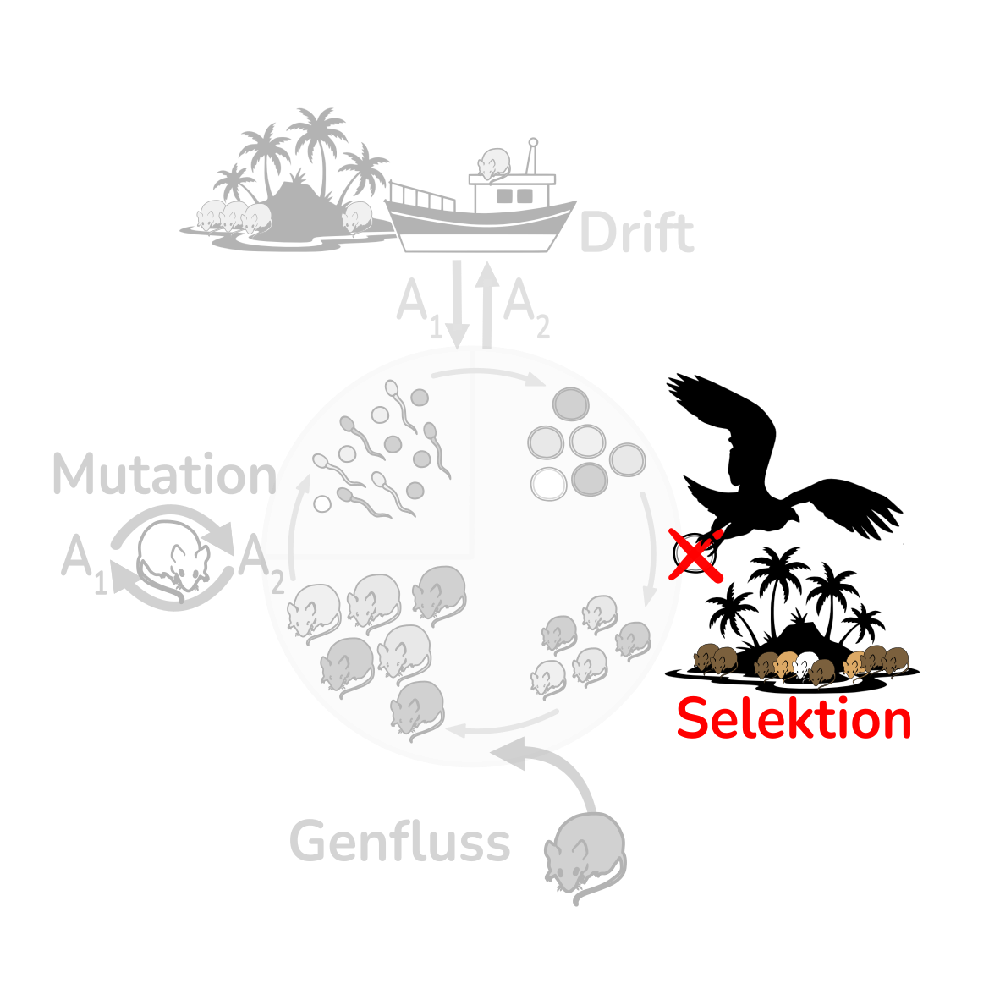



<!-- Intro text left, life-cycle wheel right (stacked on a phone).
     The wheel greys out everything but Selektion: images/lebenszyklus-selektion.svg -->
::::: {.intro-pair}
:::: {.intro-text}
Selektion wirkt, wenn Genotypen unterschiedlich viele überlebende Nachkommen haben. Jedem Genotyp wird dafür eine
**relative Fitness** zugeordnet. Das geschieht über den Selektionskoeffizienten $s$ und den
Dominanzkoeffizienten $h$:

$$
w_{11} = 1 \qquad w_{12} = 1 - hs \qquad w_{22} = 1 - s
$$

Mit $h = 0$ ist B₁ dominant, mit $h = 1$ rezessiv. Wie schnell sich $p$ ändert, hängt also von der Fitness, von $p$ selbst
und von der Dominanz ab.
::::
:::: {.intro-figure}
{fig-alt="Lebenszyklus der Mäuse mit Adulten, Gameten, Zygoten und Juvenilen. Hervorgehoben ist der Selektionspfeil, die übrigen Prozesse sind ausgegraut."}
::::
:::::

## Ausprobieren

Wählen Sie ein Fallbeispiel oder stellen Sie selbst ein, welcher Anteil jedes Genotyps überlebt. Die relative
Fitness $w$ ergibt sich daraus, indem man durch den grössten Anteil teilt: Der beste Genotyp hat $w = 1$.
Überleben alle Genotypen gleich gut (z. B. je 40 %), sind alle $w = 1$, und es gibt keine Selektion.

```{ojs}
//| panel: input
viewof preset = Inputs.select(
  new Map([
    ["Eigene Werte", null],
    // Lecture examples (Keller Vorlesung 8/9). Earlier presets kept as comments:
    // ["Laktase-Persistenz (B₁ dominant, w₂₂ = 0.9)", {p0: 0.05, generations: 200, w11: 1, w12: 1, w22: 0.9}],
    // ["Fellfarbe Schäferhund (B₁B₁ letal)", {p0: 0.5, generations: 50, w11: 0, w12: 1, w22: 1}],
    // ["Heterozygotenvorteil", {p0: 0.05, generations: 100, w11: 0.85, w12: 1, w22: 0.2}]
    ["HIV und CCR5-Δ32 (B₁ = Δ32, schützt nur B₁B₁)", {p0: 0.2, generations: 40, w11: 1, w12: 0.75, w22: 0.75}],
    ["Reismehlkäfer (B₂ rezessiv letal)", {p0: 0.5, generations: 12, w11: 1, w12: 1, w22: 0}],
    ["Heterozygotenvorteil (40 % der Homozygoten sterben)", {p0: 0.5, generations: 30, w11: 0.6, w12: 1, w22: 0.6}]
  ]),
  {label: "Fallbeispiel"}
)
```

```{ojs}
//| include: false
start = preset ?? {p0: 0.1, generations: 100, w11: 1, w12: 0.95, w22: 0.9}
```

```{ojs}
//| panel: input
viewof p0 = Inputs.range([0, 1], {value: start.p0, step: 0.01, label: "Start-Allelfrequenz p₀"})
viewof generations = Inputs.range([1, 1000], {value: start.generations, step: 1, label: "Generationen"})
viewof w11 = Inputs.range([0, 1], {value: start.w11, step: 0.01, label: "Überlebensanteil B₁B₁"})
viewof w12 = Inputs.range([0, 1], {value: start.w12, step: 0.01, label: "Überlebensanteil B₁B₂"})
viewof w22 = Inputs.range([0, 1], {value: start.w22, step: 0.01, label: "Überlebensanteil B₂B₂"})
viewof finite = Inputs.toggle({label: "Endliche Population (mit Drift)", value: false})
viewof N = Inputs.range([10, 10000], {value: 500, step: 1, transform: Math.log, label: "Populationsgrösse N", disabled: !finite})
viewof seed = Inputs.button("Neu simulieren", {value: 1, reduce: (v) => v + 1})
```

```{ojs}
wmax = Math.max(w11, w12, w22)
rel = (w) => wmax > 0 ? (w / wmax).toFixed(2) : "–"
html`<p class="result">Relative Fitness (geteilt durch den grössten Überlebensanteil):
<b>w₁₁ = ${rel(w11)}</b> · <b>w₁₂ = ${rel(w12)}</b> · <b>w₂₂ = ${rel(w22)}</b></p>`
```

```{ojs}
res = R.call("experiment", {p0, generations, w11, w12, w22, N: finite ? N : Infinity, replicates: finite ? 10 : 1, seed}, {key: "sel-main"})
alleleTrajectoryPlot(Plot, res.rows, {width, yLabel: "Allelfrequenz p (B₁)"})
```

```{ojs}
html`<p class="result">Nach ${generations} Generationen: <b>p = ${res.rows.at(-1).p.toFixed(3)}</b>${finite ? " (Mittel über 10 Populationen)" : ""}.</p>`
```

Genotypfrequenzen (gestrichelt: Erwartung nach Hardy-Weinberg bei gleichem $p$):

```{ojs}
genotypePlot(Plot, res.genotypes, {width, numbered: "B"})
```

## Dominanz macht den Unterschied

Gleiches $s$, drei Dominanzgrade. Bei seltenen rezessiven Allelen wirkt Selektion kaum, weil sie fast nur in Heterozygoten stecken.

```{ojs}
//| panel: input
viewof s_cmp = Inputs.range([0.01, 1], {value: 0.1, step: 0.01, label: "Selektionskoeffizient s"})
viewof p0_cmp = Inputs.range([0.01, 0.99], {value: 0.05, step: 0.01, label: "Start-Allelfrequenz p₀"})
```

```{ojs}
cmp = R.call("simulate_scenarios", {
  scenarios: {
    "B₁ dominant (h = 0)": {h: 0},
    "additiv (h = 0.5)": {h: 0.5},
    "B₁ rezessiv (h = 1)": {h: 1}
  },
  s: s_cmp, p0: p0_cmp, generations: 300
}, {key: "sel-cmp"})
alleleTrajectoryPlot(Plot, cmp, {width, yLabel: "Allelfrequenz p (B₁)"})
```

## Fragen

Alle Fragen lassen sich mit den Grafiken oben und mit $p^2 + 2pq + q^2 = 1$ beantworten.

1. **HIV und CCR5-Δ32:** Wählen Sie das Fallbeispiel (Start $p_0 = 0.2$) und setzen Sie danach nur $p_0$ auf 0.01.
   Die Fitness ist in beiden Fällen gleich. Warum steigt Δ32 bei $p_0 = 0.01$ in 40 Generationen kaum an?
   Berechnen Sie dazu, welcher Anteil der Zygoten B₁B₁ ist.
2. **Reismehlkäfer:** Alle B₂B₂ sterben, in jeder Generation. Warum sinkt $q$ am Anfang schnell (von 0.5 auf 0.33
   in einer Generation) und danach immer langsamer? Berechnen Sie, welcher Anteil aller B₂-Kopien bei $q = 0.5$ und bei
   $q = 0.1$ in B₂B₂-Individuen steckt.
3. **Heterozygotenvorteil:** Bei $p_0 = 0.5$ bleibt $p$ gleich, obwohl 40 % der Homozygoten sterben.
   (a) Warum ändert sich $p$ nicht? (b) Wie sehen die Genotypfrequenzen nach der Selektion aus, und gilt dort
   Hardy-Weinberg? (c) Sagen Sie voraus, was mit $p_0 = 0.2$ passiert, und prüfen Sie es.
4. **Dominanz:** Im Vergleich unten startet B₁ selten ($p_0 = 0.05$). Welche Kurve steigt am Anfang am schnellsten,
   und welche ist nach 300 Generationen am weitesten von $p = 1$ entfernt? Begründen Sie beides damit, in welchen Genotypen B₁ bzw. B₂ meistens steckt.
5. **Selektion und Drift:** Stellen Sie die Überlebensanteile 1, 0.95 und 0.9 ein und schalten Sie
   "Endliche Population" ein. Vergleichen Sie $N = 10$ mit $N = 1000$. Warum geht B₁ in kleinen Populationen manchmal
   verloren, obwohl es die höhere Fitness hat?

::: {.callout-tip collapse="true"}
## Lösungshinweise
1. Bei $p = 0.01$ sind nur $p^2 = 0.0001$ (0.01 %) der Zygoten B₁B₁. Fast alle Δ32-Kopien stecken in B₁B₂, und die
   haben dieselbe Fitness wie B₂B₂ (0.75). Die Selektion "sieht" das Allel also kaum. Bei $p = 0.2$ sind schon 4 % B₁B₁.
2. Der Anteil der B₂-Kopien in B₂B₂ ist $2q^2 / 2q = q$: bei $q = 0.5$ die Hälfte, bei $q = 0.1$ nur noch ein Zehntel.
   Der Rest steckt in gesunden Heterozygoten und wird weitergegeben. Je seltener B₂, desto besser ist es versteckt.
3. (a) B₁B₁ und B₂B₂ sind gleich häufig (je 25 %) und verlieren gleich viel. Es gehen gleich viele B₁- wie B₂-Kopien
   verloren. (b) Nach der Selektion: B₁B₁ 0.1875, B₁B₂ 0.625, B₂B₂ 0.1875. Das sind zu viele Heterozygote für $p = 0.5$
   (erwartet 0.5), also kein Hardy-Weinberg. Erst die nächste zufällige Befruchtung stellt es wieder her.
   (c) $p$ steigt auf 0.5: Das seltenere Allel steckt öfter in den bevorzugten Heterozygoten.
4. Am Anfang steckt das seltene B₁ fast nur in B₁B₂. Ist B₁ dominant ($h = 0$), haben diese Heterozygoten schon die
   volle Fitness, die Kurve steigt sofort. Ist B₁ rezessiv ($h = 1$), hilft es erst in B₁B₁, die anfangs kaum
   vorkommen. Am Ende ist B₂ selten und steckt fast nur in B₁B₂: Ist B₁ dominant, haben diese dieselbe Fitness
   wie B₁B₁, das letzte B₂ wird kaum entfernt. Darum bleibt die dominante Kurve am Ende knapp unter 1.
5. In kleinen Populationen ist der Zufall bei der Weitergabe der Allele gross im Vergleich zum Fitnessunterschied.
   Ein seltenes Allel kann durch Zufall verloren gehen, bevor die Selektion es häufiger macht. In grossen Populationen
   ist der Zufall klein und die Selektion setzt sich durch.
:::
